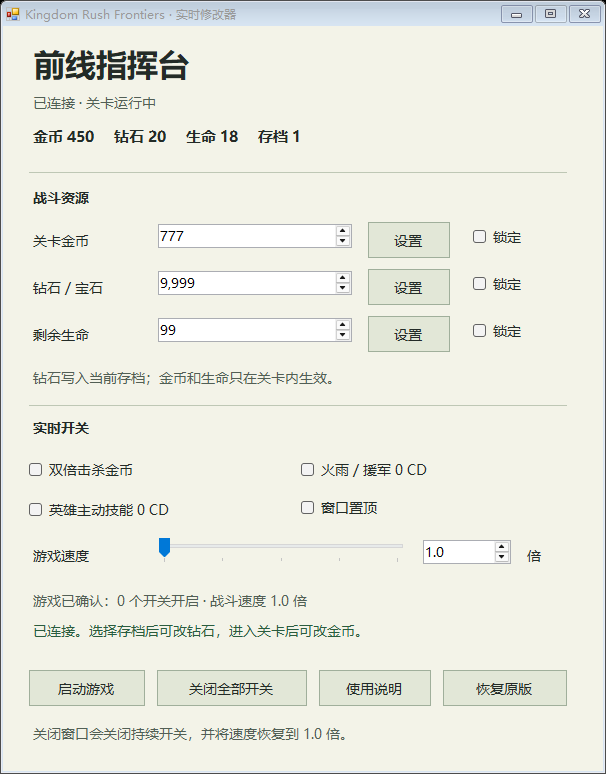

# Kingdom Rush Frontiers Trainer

Windows 原生实时修改器，适配 Steam 版《王国保卫战：前线》。



## 功能

- 双倍击杀金币。
- 设置或锁定关卡金币、存档钻石和剩余生命。
- 火雨、援军 0 CD；英雄使用 `timed_attacks.list` 的部分主动技能 0 CD。
- 战斗速度 **1.0～3.0 倍**，步进 **0.1**；滑块与数值框同步。
- 游戏连接状态、指令确认、窗口置顶及原版程序恢复。
- 关闭窗口或关闭全部开关后停止持续修改，并恢复 1.0 倍速度。

## 适配范围

当前版本针对以下安装目录和程序指纹开发：

```text
D:\Steam\steamapps\common\Kingdom Rush Frontiers
Original executable SHA256:
5670a08282f54481099d6d0a80f02669b85a26cbdb73525091e4bb625a9035da
```

安装器拒绝覆盖其他版本。当前 Windows 窗口、安装器、恢复脚本和测试使用上述游戏路径；其他路径需自行适配源码。Steam 更新或验证文件完整性可能恢复游戏原版入口。

本仓库只提供修改器自己的代码和可执行程序，不包含游戏程序、游戏 DLL、提取的游戏脚本或用户存档。需要自行安装正版游戏。

## 安装和使用

需要 Windows x64、.NET Framework 4.x；安装及开发验证另外需要 64 位 Python 3.11 或更新版本。日常运行修改器无需 Python。

1. 下载或克隆本仓库到一个固定目录。
2. 正常退出游戏。首次安装运行：

   ```powershell
   python .\install.py
   ```

3. 双击 `Frontiers修改器.exe`，再启动游戏。
4. 等待「已连接」，选择存档并进入关卡后进行设置。速度调节直接生效。

安装器会备份原版程序和安装前存档，保留游戏的原生程序部分；替换归档中的 `main.lua`，新增原始入口副本及修改器控制脚本。

**安装后不要移动修改器目录或单独搬走 exe。** 游戏接口绑定安装时的 `ipc` 路径。已安装过本工具时，先正常退出游戏，使用原目录中的「恢复原版」或恢复脚本，再安装新版本。保留旧安装报告以便恢复。

正常退出游戏后，在窗口点击「恢复原版」，或执行：

```powershell
powershell -NoProfile -ExecutionPolicy Bypass -File .\Restore-Game.ps1
```

恢复程序保留当前存档。钻石设置会写入存档，关闭开关不会撤销已设置的钻石；需要回退存档时，使用备份目录中的 `save-before-install` 副本，并留意 Steam 云同步。

## 构建

仓库中的 `Frontiers修改器.exe` 由本仓库的 `Trainer.cs` 构建。修改源码后，正常关闭修改器并执行：

```powershell
powershell -NoProfile -ExecutionPolicy Bypass -File .\Build-Controller.ps1
```

## 验证

测试依赖本机游戏自己的 LuaJIT DLL 和原始游戏函数。先从本机游戏准备测试材料，所有提取文件和存档副本都写入 Git 忽略目录：

```powershell
python .\prepare_validation.py
python .\validate.py
```

存档测试需要存在存档槽 1；它只修改工具目录里的测试副本。报告、通信文件、游戏代码和存档副本不会被提交。

已验证：原始击杀函数的金币倍率与奖励显示、原始存档方法的钻石持久化与其他字段保持一致、原始技能按钮的冷却切换、21 档速度的模拟时间与战斗 tick、暂停及单步行为、协议数值边界及指令重放拒绝、Windows 窗口通信和关闭恢复。

已在开发机器实际启动修改后的游戏，确认接口心跳及无运行时错误。**尚未完成整场关卡实战验证或实战计时，不代表所有英雄和关卡机制均已验证。**

## 文件

| 文件 | 作用 |
|---|---|
| `Trainer.cs` / `Frontiers修改器.exe` | Windows 控制窗口源码和构建产物 |
| `trainer.lua` | 本地指令处理、数值控制及速度包装 |
| `install.py` / `Restore-Game.ps1` | 指纹检查、备份、安装和恢复 |
| `prepare_validation.py` / `lua_runtime.py` / `validate.py` | 本机测试材料准备和游戏引擎验证 |
| `tests/` | 协议、归档安装及原始游戏方法测试 |

[开发机器使用说明](使用说明.md)包含该机器的安装位置和桌面快捷方式信息；其他安装以本 README 为准。
